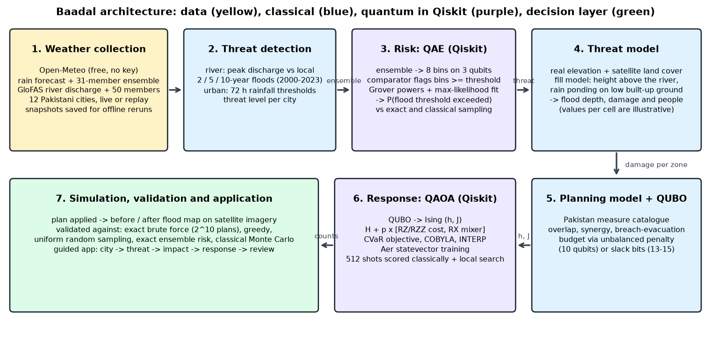
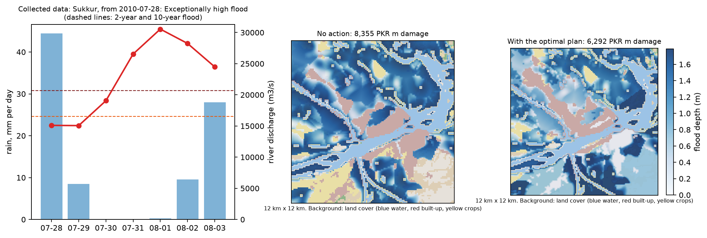
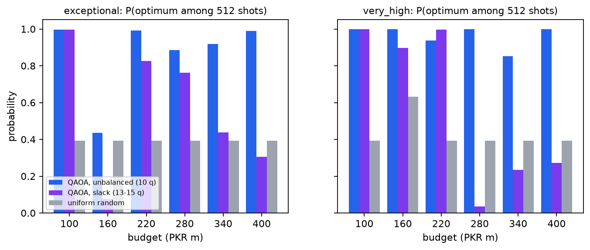

# Baadal 🌧️: from weather data to a flood response plan for Pakistan, with Qiskit

**Qiskit Fall Fest 2026 Hackathon | Domain: Disaster Response**

Baadal ("cloud" in Urdu) watches the weather over 12 Pakistani cities and turns a flood threat into a response plan:

1. **Collect** real rain forecasts, forecast ensembles and river discharge (Open-Meteo, free, no API key).
2. **Detect** a threat by comparing each city with its own flood history.
3. **Estimate the risk** with **quantum amplitude estimation (QAE)** in Qiskit.
4. **Model** the flood on the city's real elevation and land cover.
5. **Choose the response** with **QAOA** in Qiskit: the best set of protective measures within a budget.
6. **Show** the outcome as a before-and-after flood map on satellite imagery.

> Baadal collects forecasts and acts on them. It does **not** predict the weather. The quantum steps run on a simulator at small size, where classical methods can also solve the problem exactly, so every quantum result is checked against them. Weather, river flow, elevation, land cover and imagery are real public data. Asset values, population densities, costs and measure effects are **illustrative**.



## The application

`streamlit run app.py` opens one screen built around a satellite map. A progress tracker at the top shows five steps, like tracking an order:

1. **Choose city.** Pick one of 12 cities on the satellite map of Pakistan or from the list. Cities under threat are listed first.
2. **Assess threat.** The map flies to the city. The panel gives the threat level in one sentence, the chance of flooding estimated with Qiskit, and the next 7 days of rain and river flow.
3. **See impact.** The flood spreads over the satellite image, following the real ground. The panel shows the damage and people exposed if nothing is done, by area.
4. **Plan response.** A menu of measures with costs. *Recommended by Qiskit* shows the quantum plan; *Build my own* lets you add and remove measures. A summary box keeps the running total against the budget, like a cart.
5. **Review plan.** The chosen measures, the cost, what the plan saves, and a check against the best of all 1,024 possible plans.

Use *Live forecast* for today's weather or *Replay a past flood* for a saved real event. Charts, tables and benchmarks sit in the *Technical details* section below the map.

## Where Qiskit does the work

| Step | Algorithm | What it computes | Checked against |
|---|---|---|---|
| Risk | Quantum amplitude estimation, maximum-likelihood variant (4 qubits) | Probability that rainfall or river discharge exceeds the flood threshold, from the forecast ensemble | Exact value of the same distribution, and classical sampling with the same number of queries |
| Response | QAOA on a QUBO (10 qubits; 13-15 with slack bits) | The set of measures that avoids the most damage within the budget | Exact brute force over all 1,024 plans, a greedy heuristic, and random sampling |

Both circuits are written directly in core Qiskit and run on Qiskit Aer. Qiskit Optimization and Qiskit Algorithms are not used.

## Quick start

```bash
python -m venv .venv
```

Windows: `.venv\Scripts\activate`. macOS/Linux: `source .venv/bin/activate`.

```bash
pip install -r requirements.txt
```

```bash
pytest -q
```

```bash
streamlit run app.py
```

What you can run:

- `pytest -q` runs 56 checks on saved data, so it needs no internet.
- `streamlit run app.py` opens the application. The satellite imagery and the font load from the internet; everything else works offline from saved data.
- `python -m baadal.geodata` re-downloads elevation and land cover for any city missing from `data/terrain/`.
- `python -m baadal.planner` pre-computes the quantum plans for every saved event, so the app responds instantly (already done for the bundled events).
- `python -m baadal.weather --live` fetches and saves today's weather. Add `--build` to re-download the river history and all replay events.
- `python -m baadal.case_studies` reruns the end-to-end case studies and the QAE benchmark (about 10 minutes).
- `python run_pipeline.py` reruns the 12-instance QAOA benchmark (about 30 minutes); `--quick` runs one instance.
- `python make_report.py` rebuilds `docs/Baadal_Report.docx` from the saved results.

Tested on Python 3.14.6 with Qiskit 2.6.2 and Qiskit Aer 0.18.2 on Windows 10.

## How it works

**Weather collection** ([baadal/weather.py](baadal/weather.py)). For each city Baadal fetches the 7-day rain forecast, a 31-member GEFS rain ensemble, and the GloFAS river-discharge forecast with its 50-member ensemble. GloFAS history for 2000-2023 gives each river location its own 2-, 5- and 10-year flood levels. Replay mode loads the same quantities for a real past event from reanalysis archives. Every snapshot is saved under `data/`.

**Threat detection** ([baadal/threat.py](baadal/threat.py)). River cities are judged on peak discharge against their own history: 2-year flood is "high", 5-year "very high", 10-year "exceptionally high". Urban cities are judged on 72-hour rainfall (90, 150 and 230 mm; illustrative). A threat is declared when the forecast reaches "high", or when the ensemble gives at least a 30% chance of it.

**Risk with QAE** ([baadal/qae.py](baadal/qae.py)). The ensemble is loaded into 3 qubits as an 8-bin distribution. The threshold sits on a bin edge, so these coarse bins lose nothing. A comparator built from multi-controlled X gates, with no ancilla qubits, flags the bins above the threshold on a fourth qubit. Grover-style rotations and a maximum-likelihood fit then estimate the exceedance probability.

**Threat model** ([baadal/geodata.py](baadal/geodata.py), [baadal/realmodel.py](baadal/realmodel.py)). Each city has a 120 x 120 grid of 100 m cells with real elevation (AWS Terrain Tiles) and real land cover (Sentinel-2 10 m: water, built-up, crops) over 12 km x 12 km. For river cities, a land cell floods when the flood stage is above its height over the nearest river cell and it is connected to the river. For urban cities, excess rain ponds on low built-up ground. Zones for damage come from the land cover, and depth-damage curves give damage and people exposed per zone.

**Response with QAOA** ([baadal/model.py](baadal/model.py), [baadal/qubo.py](baadal/qubo.py), [baadal/qaoa.py](baadal/qaoa.py)). Each measure is one yes/no variable and one qubit. The measures come from Pakistani practice, and their interactions become the pairwise terms of the QUBO:

| Interaction | QUBO term |
|---|---|
| Two measures protect the same zone (diminishing returns) | negative `x_i x_j` |
| Spurs stop erosion that would undermine the embankment | positive `x_SPURS x_EMB_TOWN` |
| Pumps only work in outages with generators | positive `x_PUMPS x_GENSETS` |
| A controlled breach floods the right bank, and evacuation mitigates it | positive `x_BREACH x_EVAC_S` |
| Breach requires prior evacuation | penalty `P x_BREACH (1 - x_EVAC_S)` |
| Budget `sum c_i x_i <= B` | unbalanced penalty (no extra qubits) or slack bits |

QAOA is trained with COBYLA on a CVaR objective, sampled 512 times, and every sample is scored classically. A classical local search then tries single changes and swaps. The budget penalty weights are chosen against a greedy plan, without enumerating plans, so every classical part scales polynomially. Two measure catalogues are included as JSON presets: [riverine](presets/riverine_punjab.json) and [urban](presets/urban_karachi.json).

**Simulation** ([baadal/simulate.py](baadal/simulate.py)). The chosen plan is applied and shown as a before-and-after flood map with damage and people exposed.

**Interface** ([baadal_ui/index.html](baadal_ui/index.html), [app.py](app.py)). A single HTML page, hosted by Streamlit, draws the maps and animations. It evaluates the user's own plans with the same model as the Python code; we checked its numbers against the Python model by hand on the 2010 replay (before the move to real terrain; the formulas are unchanged).

## Results

**What the quantum steps achieve.** On an ideal simulator, the quantum risk estimate reached the accuracy of classical sampling with about 4.5 times fewer samples, which is the quadratic speed-up the theory predicts. The QAOA plan was checked against every possible plan in 9 real-event cases and equalled the best one in 9. These are small problems on a simulator, where classical methods can also solve the problem exactly; see Limitations.

**QAOA benchmark (12 instances of the river planning model, seeded).** The sampled QAOA plan equalled the exact optimum in 10 of 12 instances (unbalanced encoding, 10 qubits). The two misses reached 87% and 99.97% of the optimum. The trained state was 7 to 24 times more likely than random guessing to give the optimal plan. Greedy matched the optimum in 10 of 12. With a classical local-search step added, QAOA still found it in 10 of 12, and the slack-bit encoding rose from 8 to 10. For comparison, 512 random plans contained the optimum in 3 of 12 instances, and in 9 of 12 after the same local search.

**Real-event case studies.** `python -m baadal.case_studies` runs the whole chain on real past events and today's forecast, using the real-terrain flood model, and writes `results/case_studies.json`. Across 9 city cases (8 from past floods, 1 live), the quantum risk estimate was within 0.002 of the exact value. 9 cases needed a plan, and the QAOA plan equalled the exact optimum in 9 of them. The probability of the optimal plan in the trained QAOA state ranged from 0.0019 to 0.0302 (random guessing: 0.0010), so in the weakest cases the optimum was found by sampling 512 times and scoring classically, not by QAOA concentrating on it. In the 2010 super-flood replay, Baadal flags the Indus cities as exceptionally high (Sukkur at about 30,500 m³/s against a 10-year flood of 20,700) and leaves Karachi at normal.

**Risk estimator on a real ensemble** (Karachi, July 2022, exact risk 0.52, mean of 40 seeds). With 2,240 queries the QAE error was 0.0035, against 0.0074 for classical sampling. Under generic noise the QAE error rose to 0.0198, which is worse than classical sampling.




Raw data: [results/case_studies.json](results/case_studies.json), [results/results.json](results/results.json). Full QAOA table: [results/results_table.md](results/results_table.md). Report: [docs/Baadal_Report.docx](docs/Baadal_Report.docx).

## Limitations

- **Small problems on a simulator.** With 10 decisions and an 8-bin risk distribution, classical methods give exact answers in milliseconds, so the quantum steps are validated here rather than needed. We do not claim a quantum advantage. Whether QAOA helps at large sizes is an open research question.
- **Baadal does not forecast weather.** Its alerts are only as good as the forecasts it collects.
- **Replay is a hindcast.** Past events use reanalysis data, not the forecasts available at the time. Reanalysis rain underestimates cloudbursts, and GloFAS peak timing can differ from observations by days. Replay rain uncertainty is the spread over nearby grid points, and replay discharge uncertainty is an assumed 15% error, because archived ensembles are not available.
- **The flood map is a simple fill model.** It uses real elevation and land cover but has no hydraulics and knows nothing about existing embankments, canals or drains. It shows where water tends to go, not a verified flood extent.
- **Exposure and costs are illustrative.** Built-up ground and cropland are real; asset values, population densities, measure costs and measure effects are assumed, so the PKR figures are not real estimates. We tried the WorldPop population service for real counts, but it was not reachable.
- **The "with plan" map is not a new flood simulation.** It converts the planning model's remaining damage back into water depth per area. Map markers show which area a measure affects, not a construction site.
- **QAE needs deep circuits.** Reducing the register to 3 qubits halved the gate count, but the largest circuit still has several hundred CX gates, and under generic noise its precision gain disappears.
- **QAOA is a heuristic.** It missed the optimum in 2 of 12 benchmark instances, and the local-search step fixed neither. Random sampling with the same local search did almost as well (9 of 12), so at this size QAOA adds little over a simple classical method. Its penalty weights are chosen heuristically, which is not guaranteed to make the best plan the lowest-energy state.
- **Baadal is decision support.** Breaching and evacuation decisions belong to irrigation departments, PDMAs and district administrations.

## Roadmap

- A hydraulic model, and real exposure data (population, assets, existing embankments and drains).
- Archived forecasts and observed gauge data to verify alerts against what happened.
- Risk-weighted planning that feeds QAE probabilities for several severity classes into the plan.
- Hill-torrent and glacial-lake-flood regions.
- Larger plans with constraint-preserving mixers, benchmarked against MILP solvers, and IBM Quantum hardware runs.

## Originality statement

Our contribution is the **integration**: live weather collection, threat detection against local flood history, a quantum risk estimate, a flood and damage model, a quantum-optimised response chosen from **Pakistan's own flood-management measures**, and a simulated outcome, in one tested pipeline.

The comparator circuit, amplitude-estimation routine, QUBO builder, QAOA circuit and training loop were written for this project in core Qiskit. QAOA (Farhi et al., 2014), amplitude estimation (Brassard et al., 2002; Suzuki et al., 2020), CVaR (Barkoutsos et al., 2020), INTERP (Zhou et al., 2020) and unbalanced penalization (Montanez-Barrera et al., 2024) are published methods. They are credited, not claimed.

## Credits and AI-assistance note

- Weather and river data: [Open-Meteo](https://open-meteo.com) APIs, serving NOAA GEFS, ECMWF ERA5/IFS and Copernicus GloFAS data.
- Elevation: AWS Terrain Tiles (Mapzen; SRTM and other open elevation models). Land cover: Sentinel-2 10 m Land Use/Land Cover (Esri, Impact Observatory, Microsoft; CC BY 4.0). Map background: Esri World Imagery, free for non-commercial use with attribution. Google Maps imagery is not used, because its terms do not allow it.
- Depth-damage curve shapes follow Huizinga et al. (2017), JRC global flood depth-damage functions.
- Background on Pakistani practice: Federal Flood Commission reports and NFPP-IV briefs, NDMA plans, WWF/GCF Recharge Pakistan.
- This project was built with help from an AI coding assistant (Claude). The team reviewed, ran and tested all code and is responsible for it.
